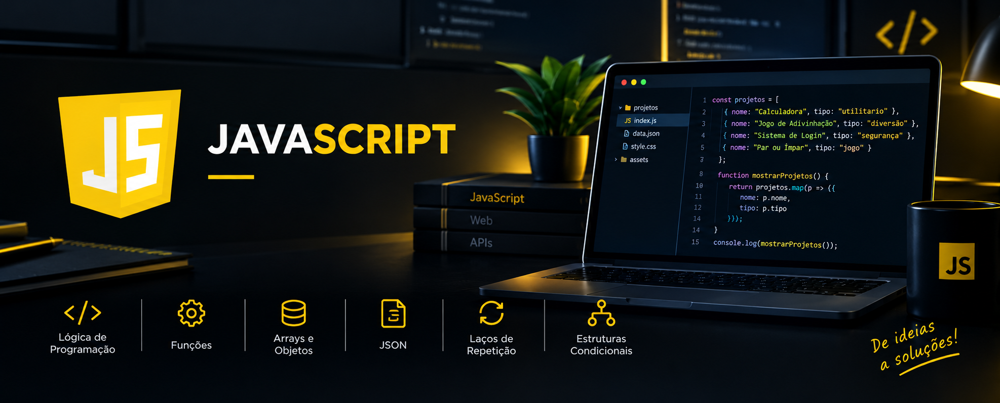

📚 Projetos em JavaScript

Repositório dedicado ao desenvolvimento de projetos práticos em JavaScript, com o objetivo de consolidar conhecimentos, aprimorar a lógica de programação e evoluir gradualmente no desenvolvimento de software.

Os projetos são desenvolvidos durante meu processo de aprendizagem, explorando conceitos fundamentais da linguagem, estruturas condicionais, funções, manipulação de dados e resolução de problemas.

🚀 Este repositório representa minha evolução contínua como desenvolvedor, reunindo exercícios e aplicações práticas desenvolvidos ao longo dos meus estudos.
